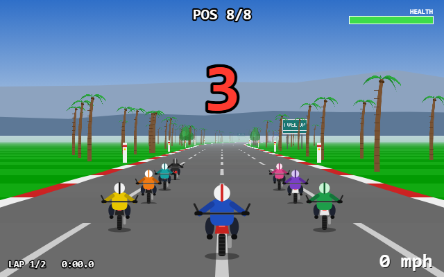
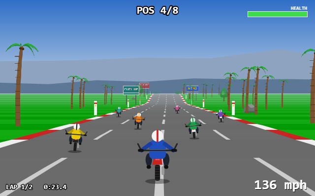
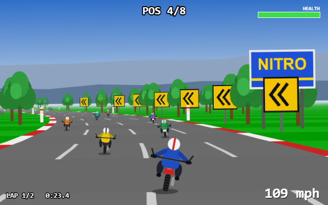
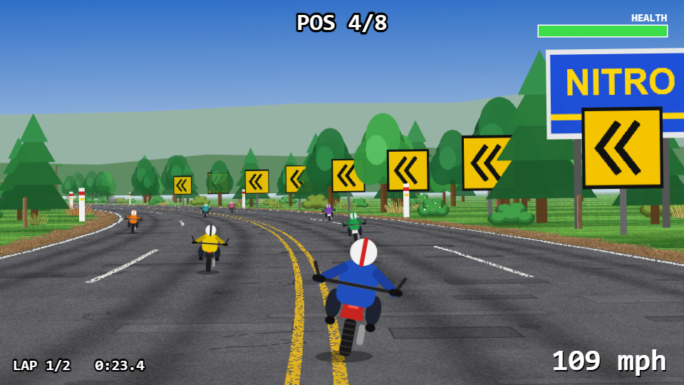
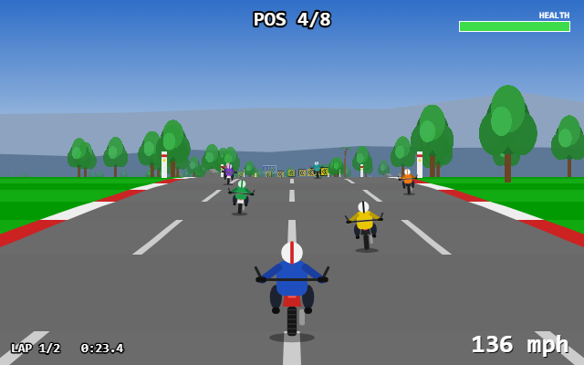
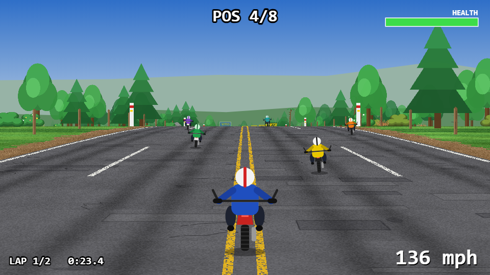
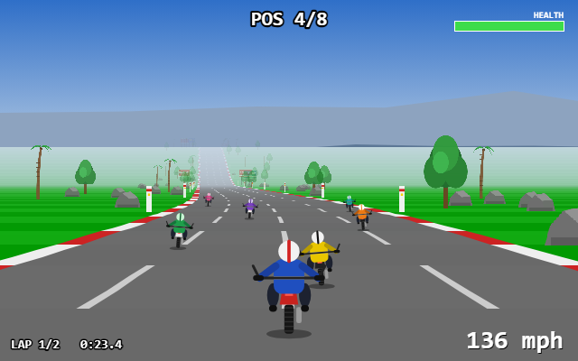
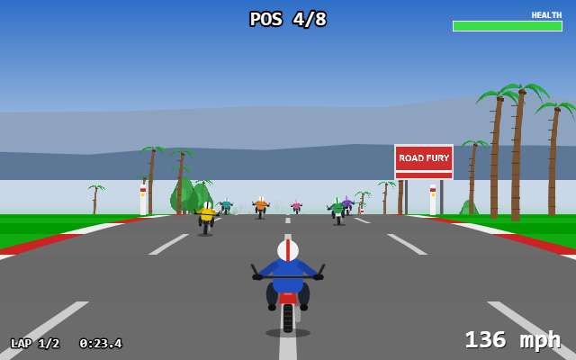
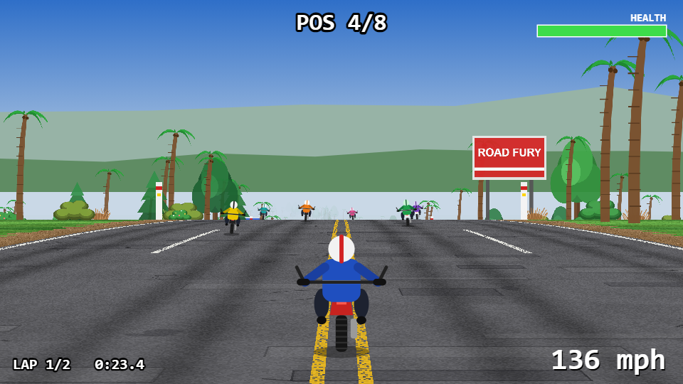

# Graphics pass A: before and after

Same six scenes rendered by the previous build (640x400, flat colours, red/white kerbs) and by this build
(960x540, textured road, dirt shoulder, dense roadside). Gameplay is identical; see the notes at the bottom.

| Scene | Before (640x400) | After (960x540) |
|---|---|---|
| Starting grid |  |  |
| Beach straight, pack ahead |  |  |
| Hard curve with chevrons |  |  |
| Forest |  |  |
| Rocky stretch |  |  |
| Just below a hill crest |  |  |

## What changed

- **Road:** asphalt with grain, soft blotches, repair patches, cracks and oil stains; darker tyre-wear tracks in every
  lane; solid white edge lines, a yellow double centre line and white dashed lane lines; a brown dirt/gravel shoulder
  with a ragged outer edge instead of red/white kerbs.
- **Terrain:** green terrain with light/dark bands and soft tonal blotches, blade streaks and specks.
- **Roadside:** dense bushes and dry scrub, trees in three shapes and varied sizes (oak, dark oak, pine), extra trees
  and palms further back, a few rocks in three tones, wooden fence posts along some stretches.
- **Camera and resolution:** internal resolution 960x540, camera height 1000 to 700 so the road fills the lower half
  of the screen. The HUD is laid out in a 640x360 space and scaled up.
- **How it stays fast:** the road and the terrain are drawn one screen row at a time from pre-generated texture strips
  (`src/render/textures.ts`), a couple of `drawImage` calls per row instead of several shapes per segment.

## Gameplay is unchanged

The track, curves and heights are identical; all 892 obstacles you could hit are in exactly the same place with the
same collision widths (the new dressing comes from a second seeded stream, and the extra trees sit more than 2.7
road half-widths out, beyond anything you can ride into); physics, rivals and the race produce identical results
(the same finish times to the tenth).

Reproduce a scene with `npm run dev` and open `/road-fury/bench/showcase.html#0` (0 to 5).
