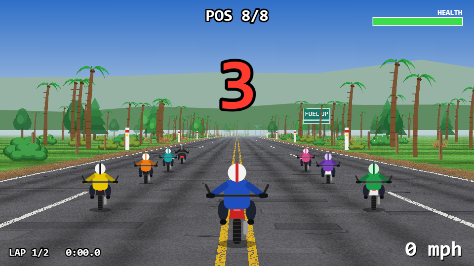
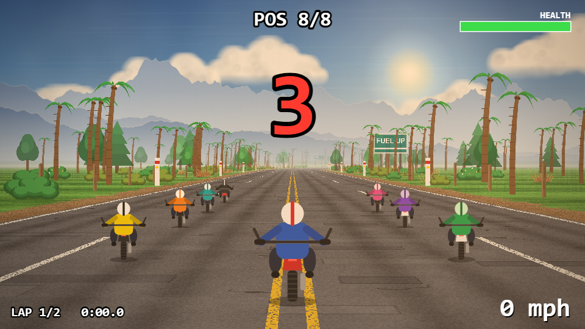
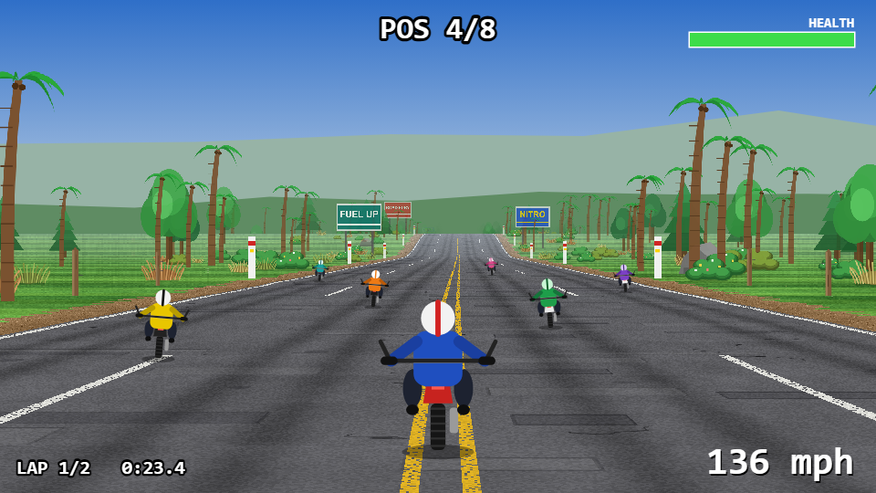
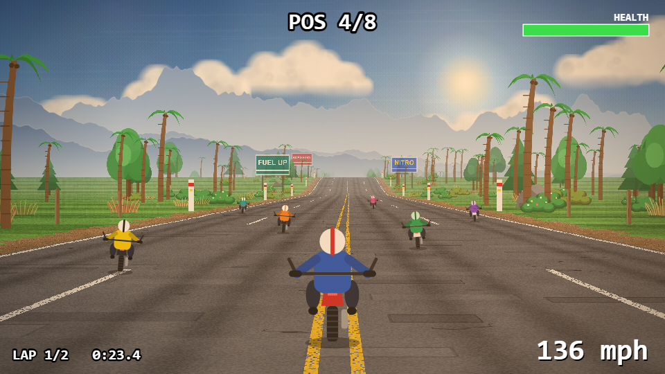
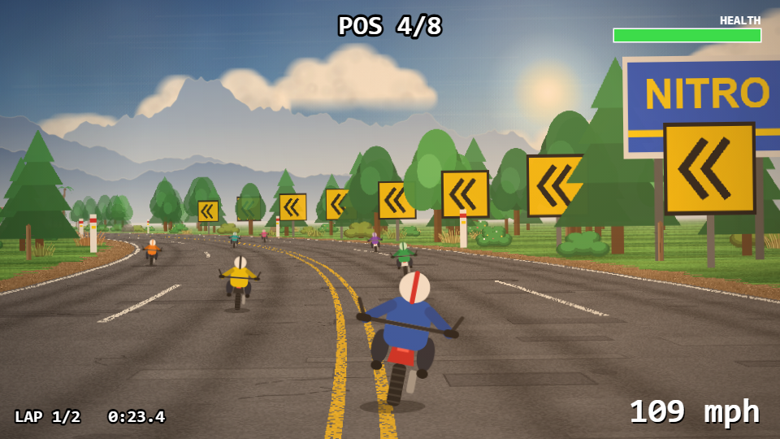
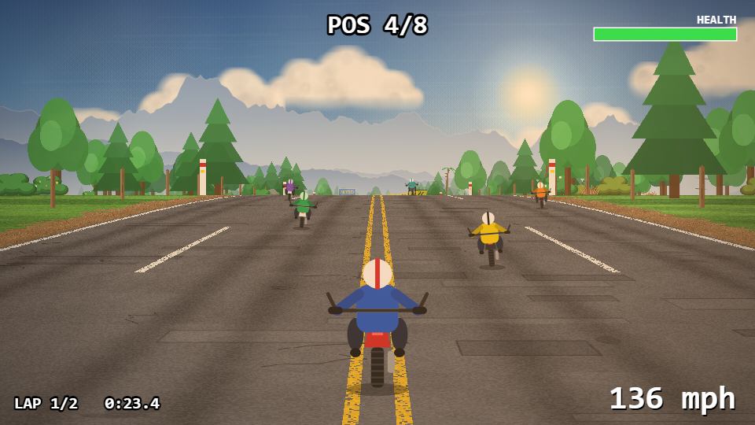
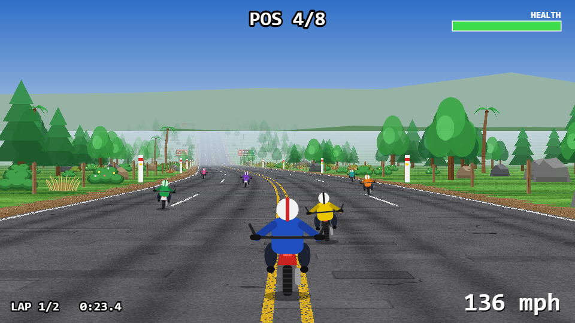
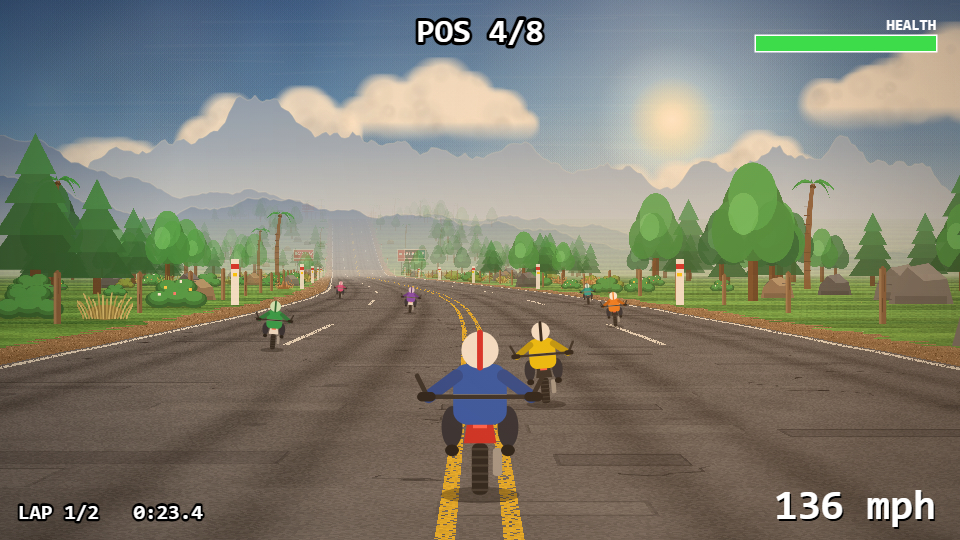
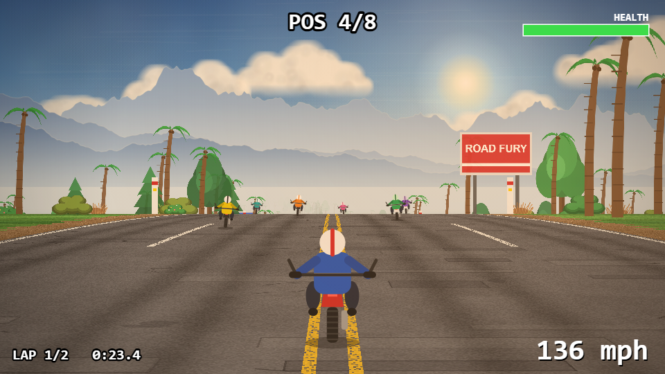

# Graphics pass B: before and after

"Before" is the build after pass A (textured road, flat blue gradient sky, two green hills); "after" adds a painted
sky with drifting clouds, a sun glow, three layers of hazy blue mountains, atmospheric haze, a warm colour grade and
a light vignette. Same six scenes, same 960x540.

| Scene | Before | After |
|---|---|---|
| Starting grid |  |  |
| Beach straight, pack ahead |  |  |
| Hard curve with chevrons |  |  |
| Forest |  |  |
| Rocky stretch |  |  |
| Just below a hill crest |  |  |

## What changed

- **Sky:** a bitmap generated in code at start-up: a blue gradient with painted-style mottling and brush streaks, and a
  warm sun glow with a soft bright core. No image files.
- **Clouds:** soft cumulus built from layered puffs (lit tops, shaded undersides, flattened soft bases), on a wrapping
  strip that drifts slowly (about 7 px a second, even when stopped) and shifts a little more on curves.
- **Mountains:** three layers of jagged hazy blue ridgelines, each lighter and fainter the further away, fading into
  the haze at the foot. They parallax on curves at three different rates.
- **Haze:** the horizon haze, the bottom of the sky and the distance fog share one colour. Distant road and terrain are
  erased toward transparent with distance, so they melt into the mountains and haze instead of ending in a flat band.
- **Grade:** a warm tint (multiply) and a light vignette baked into one overlay, plus a warm wash that glows around the
  sun. The HUD is drawn after it and is unaffected.

## Cost

Everything is pre-rendered once (about 40 ms at start-up), so each frame is a handful of blits. The grade uses two
pre-baked full-screen overlays rather than live blend modes, which are slow on a CPU canvas. On the same machine in a
software-rendered benchmark the frame costs about 1.5 ms more than pass A.

Gameplay is untouched: only rendering and two camera drift values changed.

Reproduce a scene with `npm run dev` and open `/road-fury/bench/showcase.html#0` (0 to 5).
